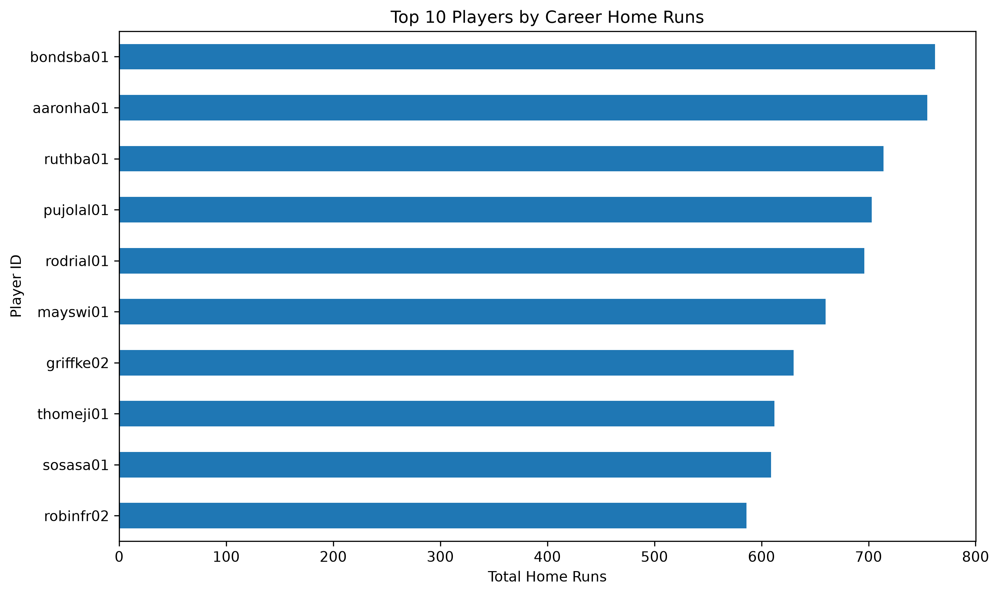

# Baseball Data Analysis with Python ⚾

## Overview

This project explores historical baseball statistics using Python. It analyses player performance, team statistics, and yearly trends to discover interesting patterns in baseball data.

The project was built as a beginner data science project to practise data analysis, data visualisation, and working with real-world datasets.

## Objectives

- Identify players with the most career home runs, hits, runs, and runs batted in (RBI).
- Explore yearly trends in home runs, hits, and strikeouts.
- Compare player performance using batting statistics.
- Analyse team performance across different seasons.
- Investigate changes in home runs across decades.
- Present findings through charts and a final statistical summary.

## Tools and Technologies

- **Python** — programming and data analysis
- **Pandas** — data cleaning, grouping, and calculations
- **Matplotlib** — data visualisation
- **CSV datasets** — storing historical baseball statistics

## Project Structure

```text
baseball-analysis/
├── charts/
│   ├── top_home_run_hitters.png
│   ├── chart_2.png
│   ├── chart_3.png
│   └── ... additional charts
├── Batting.csv
├── People.csv
├── Teams.csv
├── baseball_analysis.py
├── requirements.txt
└── README.md
```

## Key Analyses

### Player Performance
- Career home runs
- Career hits
- Career runs and RBI
- Batting averages
- Home-run and hit comparisons

### Trends Over Time
- Home runs by year
- Hits by year
- Strikeouts by year
- Number of players and teams by year
- Home-run trends by decade

### Visualisation

The project includes 18 charts illustrating player performance, team statistics, and historical trends.

## How to Run the Project

1. Install Python.
2. Install the required libraries:

   ```bash
   pip install -r requirements.txt
   ```

3. Make sure the CSV datasets are in the project folder.
4. Run the analysis:

   ```bash
   python baseball_analysis.py
   ```

5. View the charts generated by the analysis and the final summary in the terminal.

## Learning Outcomes

Through this project, I practised:

- Loading and exploring datasets with Pandas
- Grouping data and calculating statistics
- Identifying top-performing players and seasons
- Creating charts with Matplotlib
- Organising a Python project
- Communicating data-driven findings

---

*This project is part of my journey into Python programming and data science.*
## Sample Visualisation

### Top Home-Run Hitters



This chart visualises the top home-run hitters identified in the baseball dataset.
